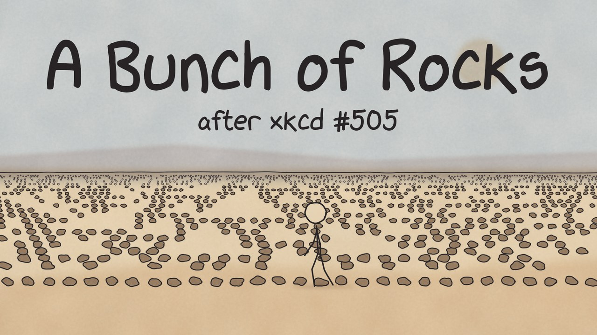

# A Bunch of Rocks: how to make a short film with an AI agent

[](https://www.youtube.com/watch?v=WGMhXgNOMvQ)

**▶ Watch the film on YouTube: [A Bunch of Rocks](https://www.youtube.com/watch?v=WGMhXgNOMvQ)** (English or German audio track)

Everyone can make animated films now. This repository shows how.

It holds everything it took to make a 5½-minute animated short film based on [xkcd #505 "A Bunch of Rocks"](https://xkcd.com/505/) by
Randall Munroe: the code, the script, the shot list and the plan. A man stuck forever in an endless desert lays rocks in rows,
turns them into a computer, and simulates a universe that may be ours.

The film was made by one person directing an AI coding agent: [Claude Code](https://claude.com/claude-code)
running Claude Opus 5.5. It started from an empty uv environment with the comic and an API key. No animation
software, no AI video, no studio:

- **Time:** about 15 hours of the human's time in all: one evening for the first complete cut (around 5 hours), then polish sessions. About 5 of those hours went into the German version.
- **Cost:** about $3.30 of ElevenLabs API calls for all voice, music and sound effects in both languages,
  re-takes included (from the project's spend ledger, `cache/audio/ledger.jsonl`).
- **Picture:** every frame is drawn by Python code that the agent wrote.

Opus 5.5 is the first model with which this worked for us end to end: planning the film, writing the script,
writing a renderer, animating 34 shots, generating and mixing the audio, and fixing what the human asked for.

This README is the story of how the film was made, and a recipe for making your own.

The screenplay is in [`docs/screenplay.md`](docs/screenplay.md). The film itself (5:46, 1920×1080, 24 fps, English and German audio tracks) is not in the repository, and neither is its audio: you build it yourself with your own ElevenLabs API key (see [Building the film](#building-the-film)). A shot-by-shot storyboard with stills, narration and sound can then be generated into `build/storyboard.html`.

## Why this comic

"A Bunch of Rocks" is my favorite xkcd. It takes only one minute to read, and I have been thinking about it for years.
Under the dry jokes it opens one philosophical question after another:

- **A god who walks.** The man in the desert has complete power over our universe. He can change any rule, undo
  anything, or simply stop. And yet he is bored, lonely, and slow: he does it all by walking, one rock at a time.
- **Can we talk to him?** He computes every one of our thoughts. Is there anything we could do, inside the
  simulation, that he would notice? And would he answer?
- **Can he get out?** He doesn't know how he got into the desert. Is his desert a simulation too, and could he ever
  leave it?
- **Could we find out?** If our world were a row of rocks, would there be a way to tell from the inside: a glitch, a
  missing rock, a dust mote that simply vanishes?
- **What is real?** If every instant of our world is a row of rocks in a desert, is it less real? Is a universe
  computed by rocks any different from one computed by anything else?

And so on. The comic answers none of these questions, and that is what makes it so good. This film tries to keep
them open, and to give the man in the desert a voice.

## How it was made

### Starting point

This is how the project began: an empty Python environment made with `uv venv` (`.venv/`, nothing installed
yet) and three files.

| File | What it is |
|---|---|
| `.venv/` | An empty Python environment (`uv venv`); the agent installed what it needed into it |
| `a_bunch_of_rocks.png` | The original comic, the only source material |
| `.env` | An ElevenLabs API key as `ELEVENLABS_API_KEY=…`, for voice, music and sound effects |
| [`AGENTS.md`](AGENTS.md) | Rules for the agent, starting with the license rule |

Everything else in this repository was made from there: the plan, the script, the code, the audio and the film.

The license rule in `AGENTS.md`: assets from the Internet or an API may only be used if their license allows
non-commercial use; otherwise the agent asks the user. The film is built on a non-commercial license (the comic's),
so every asset added later has to fit it. With the rule in place, that check does not depend on someone remembering
to ask. During the project, `AGENTS.md` grew into the agent's guide to the repository: its layout, where things go,
and how to build the film.

### Planning

The whole project was planned in a brainstorm before any code was written, led by the `brainstorming` skill from
[obra/superpowers](https://github.com/obra/superpowers). In the brainstorm, the image and animation style was chosen
from rendered sample frames, and different voices were tested with sample lines before one was picked. Every
choice was logged with its reasons and the rejected alternatives in a decision log, next to a written spec. 

### 1. Story: an expanded retelling

The comic is one tall strip of about 26 panels, all inner monologue. A straight animation would last 2–3 minutes,
so the story was expanded to four acts and the narration rewritten in a dry, deadpan first person.
Five signature lines from the comic stay word for word, such as "Sure, it's rocks instead of electricity, but
it's the same thing. Just slower." The punchline gets no extra scenes, so it doesn't drag.

The script is [`docs/script.md`](docs/script.md): spoken lines start with `N:`, and square-bracket tags like `[wearily]`
tell the voice model how to perform them.

### 2. Picture: from AI video to Python

The first plan was to generate every shot with AI video. That would have needed 40–60 separate clips that had to
look like the same character, and it was too expensive. AI images were blocked by the ElevenLabs
plan. So the film is drawn procedurally, in Python.

Four looks were tried as still frames: sketchbook, Moebius, chalk and paper cut-out. The
sketchbook look won: wobbly ink lines over muted watercolor washes on textured paper.

The first renderer, pure numpy, took **124 seconds per frame**, about 31 hours for the film. A rewrite with
skia brought that to **under 0.2 seconds per frame**. The trick is to paint the expensive watercolor
backgrounds once per shot and draw only the ink, rocks and figure on every frame.

- **24 fps with line boil.** Every line exists in three slightly different wobbles that cycle 12 times a second,
  so still drawings shimmer like hand-drawn animation (`rocks/ink.py`). The film was first made at 12 fps, like
  hand-drawn animation "on twos"; for YouTube it now renders at the standard 24 fps for smoother motion, with the
  wobble kept at its original speed.
- **A rigged stick figure.** A 2D skeleton with named poses (walk, kneel, write in the sand, look up), smooth
  blends between them, and inverse kinematics to put a hand exactly on a rock (`rocks/rig.py`).
- **A real computer.** The rows of rocks in Act 2 are a genuinely computed Rule 110 automaton, which is
  Turing-complete (`rocks/automaton.py`). In shot 2.2 he touches the three rocks above each spot before
  setting the next one, so you can see each row derive from the one before.
- **Time-lapse writing.** When he works out math in the sand, several takes of him cross-dissolve, so two or three
  of him are writing at once and time visibly passes.
- **xkcd handwriting.** All text uses the xkcd Script font, made from Randall Munroe's handwriting
  (`rocks/lettering.py`). Missing characters like ² and ₁ are drawn from its own digits.

### 3. Sound: audio first

The voice was recorded before any animation, and the picture was timed to it.

- **Narration:** ElevenLabs text-to-speech with the "Drew – Deadpan Narrator" voice and the `eleven_v3` model
 . The API returns a timestamp for every word, saved in `voice/timings.json`. One line in Act 3 was
  re-recorded with more wonder.
- **Shot list:** [`shots.yaml`](shots.yaml) places every voice line and sound effect inside every shot. Effects can
  be tied to a word: the dust flash in Act 4 lands exactly on "vanish."
- **Music:** an arc from no music, to a pulsing motif in Act 2, to a full swell for the universe, to near silence
  for the punchline. The big bang got its own cue, cut to land on the frame of the bang.
- **Sound effects:** generated from text prompts (`rocks/audio/sfx.py`). The wind took two rounds before it
  sounded like wind and not hiss. Rock clicks and footsteps come from the scenes themselves, timed to the
  animation.
- **Mix:** first done act by act, but the wind stopped at every cut. Now the whole film is mixed at once, with one
  continuous wind bed, the music ducked under the voice, and loudness set to about −16 LUFS.
- **Cost control:** every ElevenLabs request is cached by its input, so nothing is paid for twice, and spending is
  logged against a budget (`rocks/audio/el.py`; $20 unless `.env` sets `ELEVENLABS_BUDGET_USD`).
- **German version:** [`docs/script.de.md`](docs/script.de.md) translates the script line by line, recorded with the
  same voice twice: at its natural pace and a little faster (speed 1.15). Each line uses the calm recording where it
  fits the picture, the faster one where it would not. Both languages share one picture: `rocks/shots.py` fits the shot lengths
  and word cues to both recordings. A cue takes the later of the two words, and the other language waits in the last
  silence before its word, so the dust flash lands on "vanish." and on "verschwindet.". Where German needs more room,
  the shot grows for both (the film went from 5:26 to 5:46).
- **German re-takes:** single German lines were rewritten and recorded again (`RETAKES` in
  `rocks/audio/narration.py`). Recorded on its own, a short line drifts into an Austrian or English accent, so each
  re-take is recorded inside the lines around it, in German (`language_code`), and cut out at the pauses; for some
  lines only a long run-up of preceding lines kept the voice steady. A throwaway sentence after the last line keeps
  ElevenLabs from clipping its final syllable.
- **Subtitles:** made from the word timestamps (`rocks/subtitles.py`), one `.srt` per language.

### 4. The German version: where 5 hours went

The translation itself was quick. The time went into what only shows up when you listen to the film:

- **Wording that is correct but sounds wrong.** "Dann hatten die Zahlen auf einmal Meinungen übereinander",
  "Genau genommen: alle", "Also brachte ich ihm Physik bei" (as if the computer were a pupil) all became simpler
  lines. Each change means a new recording.
- **The voice drifting.** Re-takes of single lines came back with an Austrian or English accent until they were
  recorded inside their neighbouring lines (see above).
- **Timing on a shared picture.** German runs 10–30% longer, but has to land on the same frames: the dust flash, the
  rocks being laid on "Hier. Nicht hier. Hier.". Waiting for such a word first put 2–5 s holes into German lines;
  now a line starts later instead and pauses inside it grow by at most 0.4 s.
- **Cuts in the wrong place.** The word timestamps start some words late, which cut off the K of "Klar"; lines now
  start where their sound starts.

All of these fixes are in code, so another language would start from here.

### 5. Working order

To make sure the film would get finished, Act 4 (the punchline) was built first, end to end: voice, picture, music
and mix. The other acts followed one at a time, each a watchable piece on its own.

## Make your own film

This is the process that worked here. Your film can be a different comic, a short story or your own idea; only the
source and the setup change.

1. **Set up an empty folder** with an empty Python environment (`uv venv`), your source material, an API key for
   audio, and an `AGENTS.md` with the license rule (see [Starting point](#starting-point)). Use material whose
   license allows what you plan to do with the film. Install a brainstorming skill for the agent. This film used
   the `brainstorming` skill from [obra/superpowers](https://github.com/obra/superpowers) (MIT license):
   `/plugin install superpowers@claude-plugins-official` in Claude Code.
2. **Brainstorm before building.** Ask the agent to work out with you what the film should be: length, story,
   style, voice, budget. Have it write down every decision and its reasons (here: a spec and a decision log). This is what
   keeps a long project consistent.
3. **Look at samples, then choose.** Have the agent render a few still frames in different styles and pick one.
   Then let it measure how long a frame takes to render, before it builds the whole renderer.
   **Correct the course early.** The two biggest decisions here came from the human: animate in Python instead of
   paying for AI video, and "Try 12 fps with skia and cached textures" when the first renderer was far too slow.
4. **Record the voice first.** Generate the narration, listen to it, and approve it. The picture is then timed to
   the words.
5. **Build the ending first.** Make the most important scene completely, with picture, voice, music and mix. Then
   do the rest, one act at a time, and watch each act when it's done.
6. **Direct like a director.** Watch, and say what's wrong in plain words. Feedback from this film that the agent
   turned into fixes:
   - "the wind stops between the scenes" → the whole film is now mixed as one track;
   - the sentence starts "too early" after a cut → 2 s of picture added before it;
   - "blend in / blend out… multiple ones at the same time… shows that time passes" → the time-lapse writing
     shots;
   - about the font: "I hate it in the video" → all text redone in xkcd handwriting.
7. **Check the rights before you publish.** Ask the agent what each asset's license allows, and put the credits
   in the film.

## Building the film

Requirements: Linux or macOS, Python 3.10+, [uv](https://docs.astral.sh/uv/), ffmpeg, and an
[ElevenLabs](https://elevenlabs.io) API key.

The repository holds the code, the script and the shot list, but **not the film and not the audio generated with
ElevenLabs**. You generate the audio once with your own API key, then build the film:

```bash
uv sync                                          # create .venv with numpy, scipy, Pillow, skia-python, elevenlabs …
cp .env.example .env                             # then put your API key into .env
.venv/bin/python scripts/make_audio.py           # prints the cost estimate (about $1.40), spends nothing
.venv/bin/python scripts/make_audio.py --yes     # narration, music and sound effects -> voice/, music/, cache/audio/
.venv/bin/python scripts/make_film.py            # the whole film -> film/ (about 20 minutes on 8 cores)
```

`film/` then holds:

- `a_bunch_of_rocks.mp4`: the film with two audio tracks, English (default) and German, and one chapter per act.
  Players like VLC or mpv switch between the tracks and show the chapters.
- `a_bunch_of_rocks.de.m4a`: the German audio alone, exactly as long as the film.
- `a_bunch_of_rocks.en.srt`, `a_bunch_of_rocks.de.srt`: subtitles.
- `a_bunch_of_rocks.thumbnail.png`: the YouTube thumbnail (1280×720).

On YouTube: upload the MP4 (YouTube plays only its first track, English). Then in YouTube Studio, under Languages,
add German as a dub with the `.de.m4a` file, and add both `.srt` files under Subtitles. Title, description (English and
German), chapters and upload settings are in [`docs/youtube.md`](docs/youtube.md).

**Your film will sound different.** Voice and music generation is not repeatable: every run returns a new
performance, with the same script, voice, prompts and settings as the original. The picture is drawn by code and
comes out the same. But some things were tuned by ear to the original takes, so check them after generating:

- `shots.yaml`: where each voice line starts in its shot, and the German word of each cue (`de:`). The tests
  (`pytest`) report a line that no longer fits or a cue word that is missing.
- The re-takes (`RETAKES` in `rocks/audio/narration.py`): they are played from where their speech starts to where it
  ends, found in the audio, so they need no tuning; but listen to them, a new performance can miss the point of the
  line. Record one again on its own with `make_audio.py --retake <file> --yes`. German re-takes are recorded inside
  their neighbouring lines, which are cut away again: recorded alone, a short line drifted into an English or
  Austrian accent.
- `scripts/make_music.py`: where the Act 3 music is cut (`SCORE_HUSH_END`, `BUILD_SEARCH`), measured on the
  original score and cue.

Generated audio is cached in `cache/audio/`, so running `make_audio.py` again costs nothing, and every request is
logged with its cost in `cache/audio/ledger.jsonl` (capped at $20, or `ELEVENLABS_BUDGET_USD` in `.env`).

After changing some parts, render only those again; the mix, subtitles and thumbnail are always redone:

```bash
.venv/bin/python scripts/make_film.py --acts 1,2    # parts 1 and 2 again, the others from build/
```

`make_film.py` runs these steps, which can also be run one by one:

```bash
.venv/bin/python -m rocks.build 2         # render one part (0–5) -> build/act2_silent.mp4 + contact sheet
.venv/bin/python scripts/make_music.py    # fit the music to the picture -> music/act2–5.wav
.venv/bin/python -m rocks.filmmix         # one continuous mix per language, the film -> film/a_bunch_of_rocks.mp4
.venv/bin/python -m rocks.subtitles --lang de   # subtitles -> film/a_bunch_of_rocks.de.srt
```

More tools:

```bash
.venv/bin/python -m rocks.mix 2           # one part with its own sound -> build/act2.mp4 (for checking a part)
.venv/bin/python scripts/storyboard.py    # storyboard page -> build/storyboard.html
.venv/bin/python scripts/frame.py 2.2 4.0 frame.png     # one frame of one shot
.venv/bin/python scripts/test_shot.py --lang de 2.8 test.mp4     # one shot with its sound, in German
.venv/bin/python -m rocks.shots           # where each act starts (the YouTube chapters)
.venv/bin/python -m pytest                # tests
```

Keep `.env` private. `.gitignore` keeps it out of git, together with the film (`film/`), all renders (`build/`, `cache/plates/`)
and all generated audio (`voice/`, `music/`, `cache/audio/`). The repository is about 4 MB.

## Project layout

```
shots.yaml           shot list: scenes, durations, voice and sound placement
credits.md           end-credits text (rendered into the film)
rocks/               the film's code
  config.py            resolution (scenes draw on a 1280×720 stage, rendered at 1080p), frame rate, ink color, paths
  render.py            frame loop: skia surface piped into ffmpeg
  ink.py, textures.py  hand-drawn lines, paper and watercolor
  rig.py, sprites.py   the stick figure and the rocks
  lettering.py         text in xkcd Script
  automaton.py         Rule 110
  scenes/
    act0–5.py          one function per scene; each act's SCENES maps shots.yaml names to them
    desert.py          pieces several acts share: rock rows, the Rule 110 field, the wide desert shot
    common.py          scene context (pens, plates, sprites), camera, fades, night sky
    writing.py         time-lapse writing in the sand (Act 1)
  shots.py             loads shots.yaml, fits the timing to every language, snaps sound cues to words
  subtitles.py         subtitles from the word timestamps
  build.py             renders an act
  audio/               ElevenLabs narration, music and sound effects, with caching
  mix.py, filmmix.py   per-act and whole-film mixing
scripts/
  make_audio.py        all audio, generated through the API
  make_film.py         the whole film in one command
  make_music.py        fits the music to the picture (music/act2–5.wav)
  storyboard.py        the storyboard page (layout in storyboard.html)
  frame.py             one frame of one shot -> PNG
  test_shot.py         one shot with its sound, or an alternative scene for it -> MP4
  pose_sheet.py        all poses of the stick figure -> PNG
  experiments/         the early experiments: style samples and the renderer speed test
tests/               Rule 110, and checks of the shot list and lettering
docs/script.md       narration script; docs/script.de.md: the German translation
docs/screenplay.md   the screenplay of the film
docs/thumbnail.jpg   the title image above (the YouTube thumbnail, made by scripts/thumbnail.py)
voice/, music/       generated audio (not in git; made by make_audio.py and make_music.py)
cache/audio/         every API result and the spend ledger (not in git)
fonts/               xkcd fonts and their license
film/                the finished film, its German audio and subtitles (not in git)
build/               intermediate renders and mixes, rebuilt on every run (not in git)
```

## Licenses and credits

This is a non-commercial fan adaptation and is not affiliated with or endorsed by xkcd.

- **Code** (`rocks/`, `scripts/`, `tests/`): [MIT](LICENSE). Use it for your own films, commercial or not.
- **Our film content** (scripts, screenplay, shot list, credits, docs, and the film itself):
  [CC BY-NC 4.0](LICENSE-content), as an adaptation of the CC BY-NC comic: share and adapt it with credit, but not
  commercially.
- **Third-party assets** keep their own licenses:

| What | Source | License |
|---|---|---|
| Story and signature lines | xkcd #505 by Randall Munroe | [CC BY-NC 2.5](https://creativecommons.org/licenses/by-nc/2.5/) |
| Font | [ipython/xkcd-font](https://github.com/ipython/xkcd-font) | CC BY-NC 3.0 |
| Narration, music, sound effects | ElevenLabs API | ElevenLabs terms |

Because the comic and the font are licensed for non-commercial use only, the film can be shared freely with credit
but must not be monetized. Details: [`LICENSE`](LICENSE) and [`LICENSE-content`](LICENSE-content). Rules for adding new assets are in [`AGENTS.md`](AGENTS.md).
